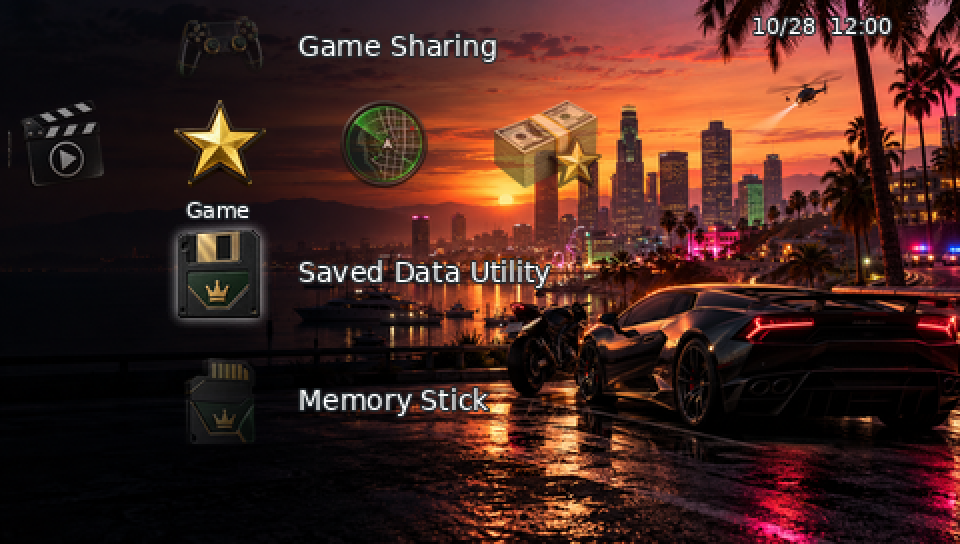

# GTA PSP Theme

An **unofficial fan-made** Grand Theft Auto-inspired PTF theme for the Sony PSP, created for Amir Saeid Dehghan. This project is not affiliated with or endorsed by Rockstar Games, Take-Two Interactive, or Sony. Grand Theft Auto and PSP are their respective owners' marks.

[فارسی](README_FA.md) · [Download PTF](GTA_PSP_Theme.ptf) · [Installation](docs/INSTALLATION.md) · [Compatibility and verification](docs/COMPATIBILITY.md) · [Asset credits](docs/ASSET_CREDITS.md)



**Image above is a software composition, not a screenshot from an installed theme.** More simulated examples: [Settings](previews/simulated-xmb-settings.png) and [Network](previews/simulated-xmb-network.png). Genuine XMB screenshots are not available yet.

## Design and content

Original AI-generated 3D-style urban artwork with dark navigational space, a warm city skyline, police lights and cars. The latest design uses AI-generated, 3D-rendered icon artwork in a black, chrome, green and gold palette. A wanted star, radio, city radar, car garage and other objects reference the GTA-inspired direction. Some related menu slots share imagery. The package has eight category slots, 29 first-level icons with focus assets, two second-level icons with focus assets, wallpaper, and two theme-selection images. Firmware-specific or unsupported XMB elements may use system icons; no fonts, layouts, sounds or system files are replaced. These graphics are fan interpretations, not official game assets.

## Install

1. Download [GTA_PSP_Theme.ptf](GTA_PSP_Theme.ptf) via the file page's download control.
2. Connect the PSP via USB or use the memory card reader. On PSP Go, select the storage in use (internal storage or Memory Stick Micro). On other models use the Memory Stick.
3. Copy the file to `PSP/THEME/` at the root of the selected storage. Create the `THEME` folder if needed. Safely eject.
4. On the PSP select **Settings → Theme Settings → Theme**, select the custom theme and apply it. See [installation details](docs/INSTALLATION.md).

## Targets and test status

PTF themes are intended for official PSP firmware with custom-theme support; target models are PSP-1000, 2000, 3000, PSP Go (N1000) and Street E1000. The build identifies firmware 6.20; compatibility with any specific firmware and model is **not device-verified**. No PSP or genuine XMB environment was available for installation, navigation, capture, or Go-specific testing. See the compatibility report before use.

The 517,848-byte PTF was built using PTF Studio's encoder and independently parsed. All 73 image resources were decoded and their dimensions checked, including indexed GIM and 480×272 24-bit BMP. This is structural validation, not proof of successful device installation. SHA-256: `f12cdc8b2b493ab2046caf8986d6e7a0f14438e3636d9f4c6d24d72941b6c14a`.

## Rebuild

Requires Python 3 with Pillow and NumPy, Node.js with `pngjs`, and [PTF Studio](https://github.com/S1implyBlue/PTF-Studio) at commit `3b2c6407201bf02a22412725c9009a52bbdf1517` (GPL-3.0). Inkscape is needed only if re-exporting SVG masters. Project inputs are already exported under `assets/`.

```sh
npm install --no-save pngjs
export PTF_STUDIO_DIR=/path/to/PTF-Studio
python3 tools/verify_assets.py
node tools/build_ptf.cjs
python3 tools/verify_ptf.py release/GTA_PSP_Theme.ptf
```

The builder extracts functions from the specified PTF Studio checkout at build time; it is not bundled. `tools/prepare_assets.py` regenerates focus and preview resources; `tools/make_previews.py` generates simulated compositions. `artwork/3d/` contains flattened AI-generated high-resolution atlas and wallpaper masters for the current theme; `artwork/icons/` contains the earlier vector design, not the current artwork. To regenerate device images, run `python3 tools/export_3d_assets.py` then `python3 tools/prepare_assets.py`. The generated masters are not editable 3D models or layered files. See [credits](docs/ASSET_CREDITS.md). Root PTF and release copy are identical. Artwork and scripts are organized in `artwork/`, `assets/`, `tools/`, `previews/`, `docs/` and `release/`.

## Limitations

No actual PSP screenshots or hardware validation; image generation is flattened, and appearance on a real XMB can differ from simulations. Availability of some icons varies by firmware/model. PTF cannot replace the entire interface or add functionality. Feedback from a real PSP Go would help verify compatibility.
