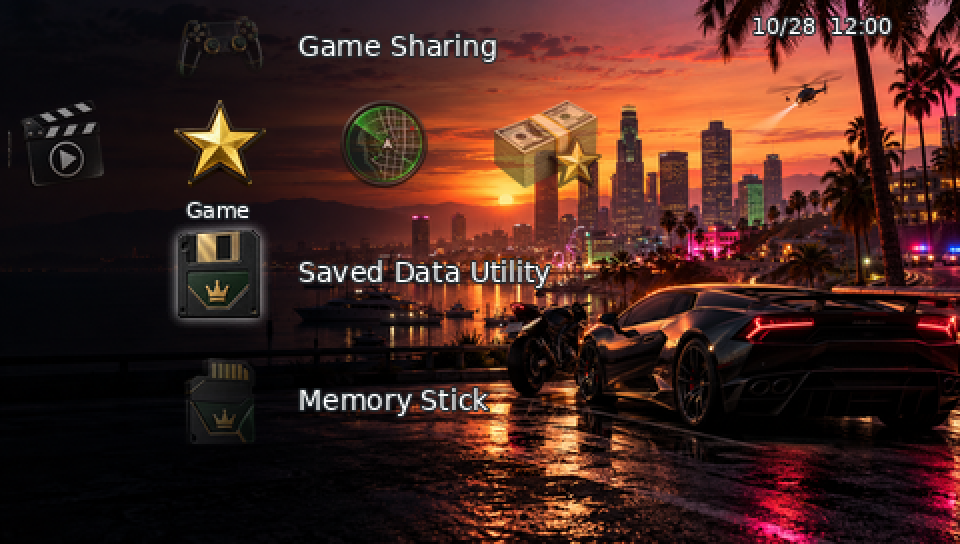

<div dir="rtl">

# تم GTA برای PSP

این پروژه یک تم **غیررسمی و طرفداری** با الهام از Grand Theft Auto برای PSP است و برای امیر سعید دهقان تهیه شده است. این پروژه وابسته به Rockstar Games، Take-Two Interactive یا Sony نیست.

[English](README.md) | [دانلود فایل PTF](GTA_PSP_Theme.ptf) | [راهنمای نصب](docs/INSTALLATION.md) | [سازگاری و آزمایش‌ها](docs/COMPATIBILITY.md) | [منابع](docs/ASSET_CREDITS.md)



**این تصویر شبیه‌سازی گرافیکی است و اسکرین‌شات تم نصب‌شده روی PSP نیست.** تصاویر شبیه‌سازی‌شدهٔ دیگر: [Settings](previews/simulated-xmb-settings.png) و [Network](previews/simulated-xmb-network.png). در حال حاضر اسکرین‌شات واقعی در دسترس نیست.

## طراحی و امکانات

تصویر اصلی شهر، خودروها، نور پلیس و فضای تاریک برای خوانایی منو دارد و با هوش مصنوعی تولید شده است. آیکون‌های جدید با ظاهر رندر سه‌بعدی و رنگ‌های مشکی، کروم، سبز و طلایی با هوش مصنوعی ساخته شده‌اند؛ ستارهٔ تعقیب، رادیو، رادار نقشه و گاراژ از نمادهای استفاده‌شده هستند. برخی گزینه‌های مرتبط از تصویر مشترک استفاده می‌کنند. فایل شامل ۸ جایگاه دسته‌بندی، ۲۹ آیکون سطح اول به‌همراه تصویر انتخاب، دو آیکون سطح دوم با تصویر انتخاب، پس‌زمینه و تصاویر انتخاب تم است. همهٔ گزینه‌های سیستمی و مدل‌ها الزاماً جایگاه اختصاصی قابل تعویض ندارند.

## نصب روی PSP و PSP Go

۱. فایل [GTA_PSP_Theme.ptf](GTA_PSP_Theme.ptf) را از صفحهٔ فایل با گزینهٔ دانلود دریافت کن.

۲. دستگاه را با USB وصل کن یا از کارت‌خوان استفاده کن. در PSP Go حافظهٔ داخلی یا کارت Memory Stick Micro مورد استفاده را انتخاب کن؛ در مدل‌های دیگر از Memory Stick استفاده کن.

۳. فایل را در مسیر `PSP/THEME/` در ریشهٔ همان حافظه قرار بده. اگر پوشهٔ `THEME` وجود ندارد، بساز. حافظه را ایمن جدا کن.

۴. از منوی دستگاه وارد **Settings → Theme Settings → Theme** شو، تم را انتخاب و اعمال کن.

## سازگاری و وضعیت تست

مدل‌های هدف PSP-1000، PSP-2000، PSP-3000، PSP Go و PSP Street هستند، به شرط پشتیبانی سیستم‌عامل از تم سفارشی PTF. متادیتای خروجی نسخهٔ ۶٫۲۰ را مشخص می‌کند. **هیچ‌یک از این مدل‌ها به‌صورت فیزیکی یا در محیط واقعی XMB آزمایش نشده‌اند**؛ در نتیجه سازگاری عملی، از جمله با PSP Go، هنوز تأیید نشده است. PTF جایگزین سیستم‌عامل، فونت یا چیدمان XMB نیست.

فایل ۵۱۷٬۸۴۸ بایت است. ساختار آن با ابزار سازنده و بررسی مستقل کنترل شده و ابعاد ۷۳ تصویر و فرمت منابع بررسی شده‌اند. این بررسی به معنی تأیید نصب روی دستگاه نیست. هش SHA-256 فایل:

`f12cdc8b2b493ab2046caf8986d6e7a0f14438e3636d9f4c6d24d72941b6c14a`

## ساخت دوباره از سورس

به Python 3 همراه Pillow و NumPy، Node.js همراه بستهٔ pngjs و سورس [PTF Studio](https://github.com/S1implyBlue/PTF-Studio) در commit `3b2c6407201bf02a22412725c9009a52bbdf1517` نیاز داری. برای تبدیل مجدد SVGها به PNG از Inkscape استفاده کن. فایل‌های آمادهٔ ساخت در `assets/` قرار دارند.

</div>

```sh
npm install --no-save pngjs
export PTF_STUDIO_DIR=/path/to/PTF-Studio
python3 tools/verify_assets.py
node tools/build_ptf.cjs
python3 tools/verify_ptf.py release/GTA_PSP_Theme.ptf
```

<div dir="rtl">

پوشهٔ `artwork/3d/` تصاویر اصلی تخت و باکیفیت آیکون‌ها و پس‌زمینهٔ جدید را دارد؛ `artwork/icons/` حاوی نسخهٔ برداری قدیمی است، `assets/` تصاویر آمادهٔ ساخت، `tools/` اسکریپت‌ها، `previews/` تصاویر شبیه‌سازی و `release/` نسخهٔ خروجی را دارد. فایل مدل سه‌بعدی یا سورس لایه‌باز برای تصاویر تولیدشده موجود نیست؛ خود PSP تصاویر ثابت رندرشده را نمایش می‌دهد. اطلاعات سازندگان و مجوزها در [راهنمای منابع](docs/ASSET_CREDITS.md) آمده است.

**محدودیت:** پیش‌نمایش‌ها ممکن است با دستگاه واقعی تفاوت داشته باشند و عکس واقعی از تم نصب‌شده هنوز تهیه نشده است.

</div>
